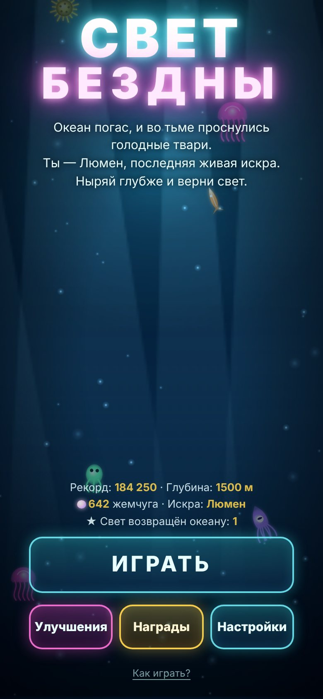
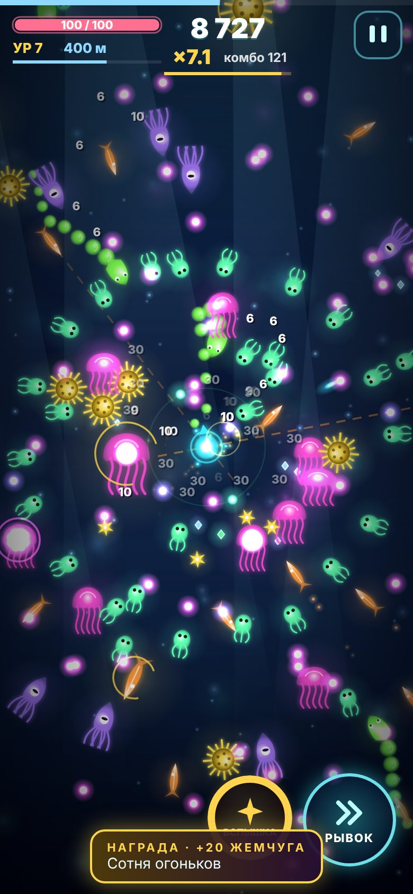
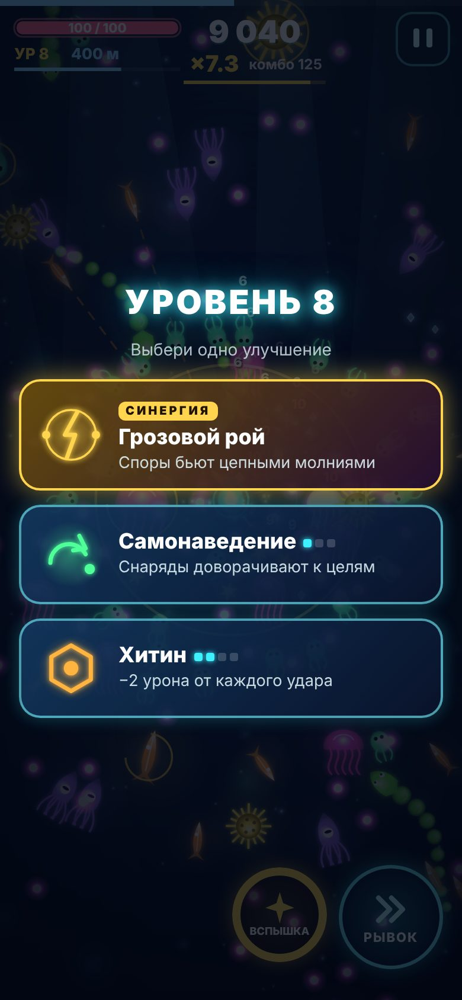
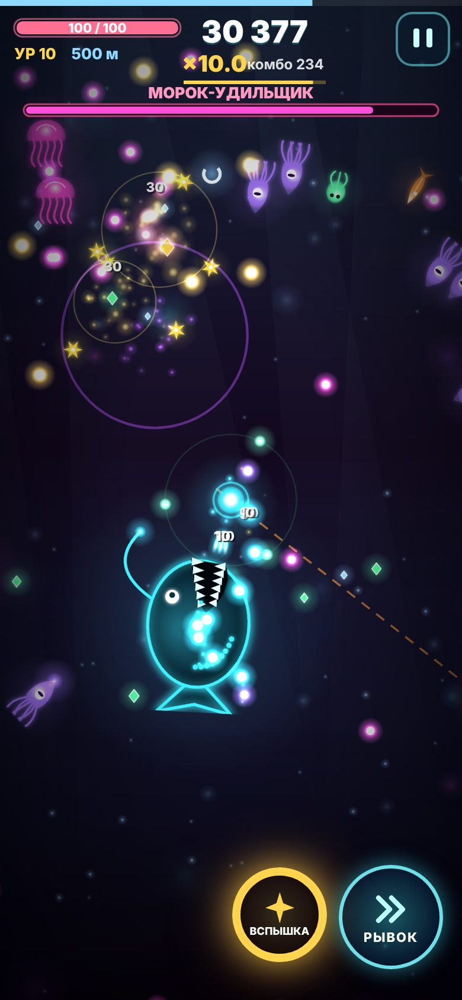

# Свет Бездны

**Океан погас, и во тьме проснулись голодные твари. Ты — Люмен, последняя живая искра. Ныряй глубже и верни свет.**

Неоновый экшен-«выживач» для телефона: плаваешь светящейся искрой по тёмной глубине, стреляешь сам собой по
светящимся тварям, собираешь искры опыта, выбираешь улучшения, складываешь их в золотые синергии и
спускаешься всё глубже — к владыкам бездны.

 
 

## Как открыть

- **На Android:** скопируй `index.html` на телефон и открой в Chrome (или открой ссылку на файл из репозитория
  через любой статический хостинг). Интернет не нужен — вся игра в одном файле, без внешних ресурсов.
- **На компьютере:** просто открой `game/index.html` в браузере.

## Управление

| Действие | Телефон | Клавиатура |
|---|---|---|
| Плыть | веди пальцем в любом месте экрана (плавающий джойстик) | WASD / стрелки |
| Стрельба | автоматически по ближайшей видимой цели | — |
| Рывок (неуязвимость) | кнопка «РЫВОК» | Пробел / Shift |
| Вспышка (заряжена) | кнопка «ВСПЫШКА» | E / Q / Enter |
| Пауза | кнопка вверху справа | Esc / P |
| Выбор улучшения | тап по карте | 1 / 2 / 3 |

## Что внутри

- **Глубина вместо волн:** каждую минуту — ещё 100 м, у каждой зоны своё имя, свой цвет и новые твари.
- **7 видов врагов** со своим поведением: планктонник (рой), игла-рыба (прицеливается и бросается),
  медуза (кольца пуль), ёж (раскалывается на шипы), угорь (длинное ранящее тело), кальмар-снайпер
  (держит дистанцию и стреляет), панцирник (щит спереди — заходи сбоку). Элитные золотые версии с жемчугом.
- **3 босса:** «Морок-Удильщик» (500 м) — спирали пуль, гипнотическая приманка, которая тянет к пасти,
  серии бросков и призыв планктона; «Матерь Глубин» (1000 м) — шесть вращающихся щупалец, кольца
  с просветами, спирали, веера и призыв медуз; «Сердце Бездны» (1500 м) — финал истории: золотые
  кристаллы-щиты (пока они целы, сердце почти неуязвимо), вращающиеся лучи, затмение с самонаводящимися
  тёмными искрами и телепорт с кольцами. У всех ярость на половине здоровья. Дальше — бесконечный спуск,
  боссы возвращаются сильнее.
- **19 улучшений и 6 синергий** (Грозовой рой, Сверхновая, Призма, Ледяная бездна, Охотник, Прилив):
  веер снарядов, пробивание, рикошет, криты, цепные молнии, споры-спутники, импульс, мины, холод,
  самонаведение и др.
- **Комбо-множитель** до ×10, вехи комбо, «грейз» — пули, пролетевшие впритирку, дают очки и заряд Вспышки.
- **Вспышка** — ультимейт: стирает все пули, бьёт всё на экране, мир на миг замирает.
- **Мета-прогресс:** жемчуг сохраняется между заплывами; постоянные усиления, 3 искры-персонажа
  (Люмен, Игла, Панцирь), 6 обликов, 16 наград-достижений.
- **Сочность:** неоновое свечение, параллакс «морского снега» и лучей, тряска, хит-стоп, вспышки попаданий,
  взрывы, цифры урона.
- **Звук:** все эффекты синтезируются Web Audio, генеративная музыка ускоряется на глубине и в бою с боссом.
  Вибрация на попаданиях и взрывах.
- **Настройки:** звук, музыка, вибрация, графика (авто/высокая/эконом — «авто» сама снижает разрешение и эффекты, если телефон не тянет 60 к/с), цифры урона, тряска экрана.
  Всё сохраняется в браузере (если хранилище недоступно — игра просто работает без сохранений).

## Для разработчиков

Один файл `index.html`, без сборки. JS разбит на разделы: CONFIG, UTILS, SAVE, AUDIO, SPRITES, STATE,
INPUT, SYSTEMS, RENDER, UI, MAIN LOOP. Пулы объектов без аллокаций в горячих циклах, пространственная
сетка для столкновений, предрендер свечения и существ в offscreen canvas. Для автотестов есть отладочный
хук `window.__SB` (`startRun()`, `jumpZone(z)`, `giveXP(n)`, `god(true)`, `up(id, n)`, `killBoss()`, `setQuality(q)`, `qLevel()`, `PERF`).
