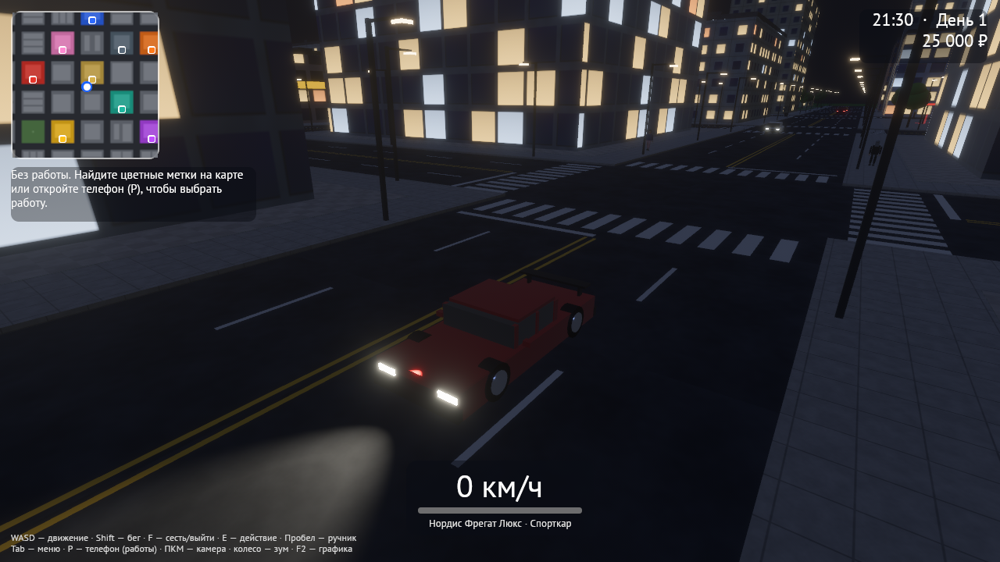
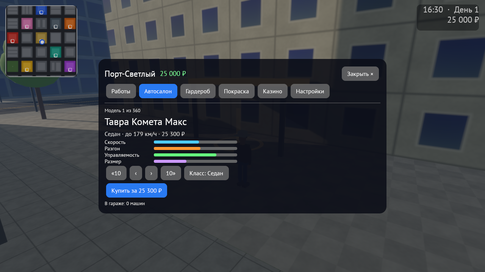
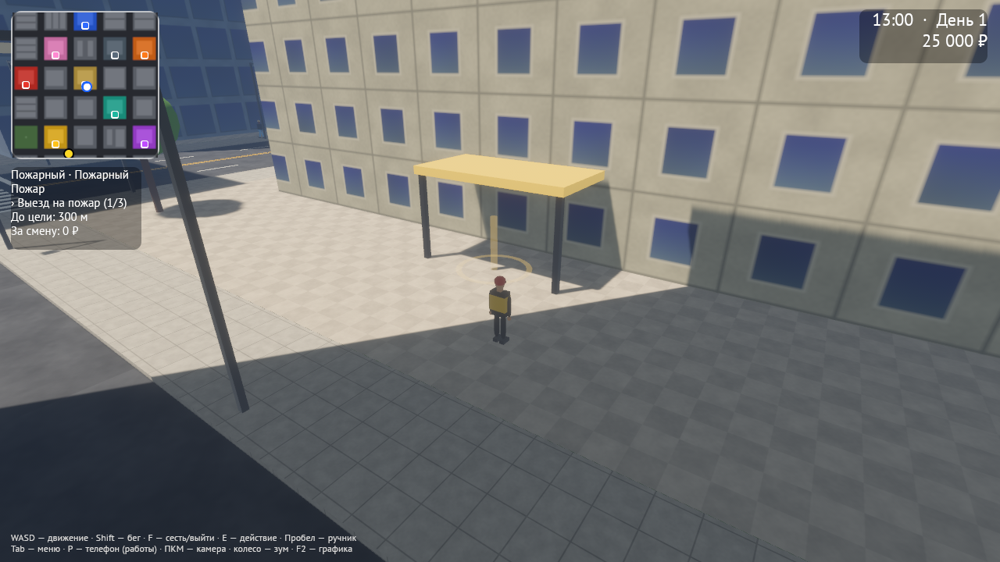
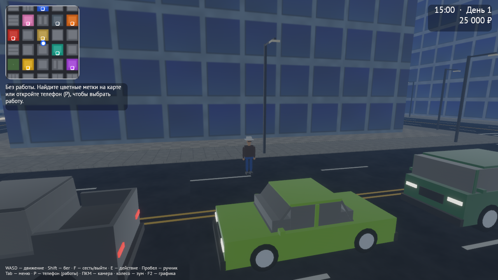

# Порт-Светлый

Своя 3D-игра в открытом мире на **Rust** и движке **Bevy 0.16**: портовый город,
машины, работы и фракции, день и ночь. Всё написано с нуля: город, 360 моделей
машин, 400 скинов, текстуры и интерфейс генерируются кодом, без чужих ассетов.



## Что есть

- **Город** 12×12 кварталов: центр с небоскрёбами, панельки и кирпичные дома,
  частный сектор, парки, пляж с пальмами, пирс и море. Дороги с разметкой,
  зебрами и фонарями. Окна домов светятся ночью.
- **День и ночь**: солнце, луна, закаты, туман, тени, свечение (bloom), фары.
- **360 моделей машин** в 10 классах: седан, хэтчбек, универсал, купе, спорткар,
  внедорожник, пикап, фургон, грузовик, автобус. У каждой своя скорость, разгон
  и управляемость. **58 покрасок**: глянец, металлик, мат, перламутр, хром,
  гоночные полосы. Плюс служебные ливреи с мигалками.
- **400 скинов** персонажей и униформа для каждой работы.
- **15 работ и фракций** с рангами и зарплатой, которая растёт с рангом:
  таксист, курьер, водитель автобуса, дальнобойщик, инкассатор, пожарный,
  врач скорой, инспектор ГИБДД, оперативник ФСБ, журналист, водолаз, ОПГ
  (с погоней и розыском), сотрудник мэрии, механик, мусорщик.
- **Казино** (слоты и рулетка), **автосалон**, **магазин одежды**, **покраска**.
- **Трафик**, который едет по полосам и поворачивает на перекрёстках,
  **пешеходы**, полиция, которая гонится за игроком при розыске.
- **HUD**: миникарта с метками, GPS, спидометр, деньги, часы, уведомления.
- **Android**: сенсорный стик, кнопки, обзор свайпом, пресеты графики под телефон.

| Автосалон | Работа пожарного | Машины |
|---|---|---|
|  |  |  |

## Управление

| ПК | Телефон | Действие |
|---|---|---|
| WASD / стрелки | левый стик | ходьба, газ/тормоз и руль |
| Shift | «Бег» | бег |
| F | «Сесть/Выйти» | сесть в ближайшую машину или выйти |
| E | «Действие» | устроиться на работу, войти в казино или магазин |
| Пробел | «Тормоз» | ручник (занос) |
| Tab | «Меню» | меню: работы, автосалон, гардероб, покраска, казино, настройки |
| P | «Телефон» | список работ и GPS |
| ПКМ + мышь, колесо | свайп справа | камера и зум |
| F2 | меню → Настройки | качество графики |

Как начать: откройте телефон (P), поставьте GPS на штаб нужной работы, дойдите
до цветной метки у входа и нажмите E. Служебная машина будет ждать у входа.

## Запуск на ПК

```bash
cargo run --release
```

Под Linux нужны `libasound2-dev`, `libudev-dev` и драйвер Vulkan, под Windows и macOS
ничего дополнительно ставить не надо.

## Сборка APK под Android

Нужны Android SDK и NDK, JDK 17+, `rustup target add aarch64-linux-android`
и `cargo install cargo-ndk`.

```bash
export ANDROID_HOME=/путь/к/android-sdk
./android/build-apk.sh
# APK: android/app/build/outputs/apk/release/app-release.apk
```

APK подписан отладочным ключом, поэтому ставится на телефон сразу (нужно
разрешить установку из неизвестных источников). Для публикации нужен свой ключ.

Оптимизация для телефонов: статичный город склеен в крупные меши по кварталам
(мало вызовов отрисовки), у текстур есть mip-уровни, на низком качестве
отключены HDR, bloom, MSAA и тени, меньше трафика и пешеходов.

## Как устроен код

| Файл | Что внутри |
|---|---|
| `src/city.rs` | генерация города, текстуры фасадов, коллизии, миникарта |
| `src/vehicles.rs` | каталог 360 машин, покраски, сборка модели, физика |
| `src/character.rs` | 400 скинов, униформа, тело и анимация ходьбы |
| `src/player.rs` | игрок: ходьба, плавание, посадка в машину |
| `src/traffic.rs` | трафик, пешеходы, полицейская погоня |
| `src/jobs.rs` | работы, ранги, генератор заданий |
| `src/menu.rs` | меню: автосалон, гардероб, покраска, казино, настройки |
| `src/hud.rs` | миникарта, спидометр, уведомления |
| `src/scene.rs` | камера, день и ночь, качество графики |
| `src/input.rs` | клавиатура, мышь и сенсорное управление |

Новая работа добавляется одним вариантом в `JobKind` и веткой в `new_mission`.

## Чего пока нет

Честно: это первая версия. Модели собраны из простых форм (стиль low-poly),
звука, сохранения прогресса и мультиплеера пока нет. Всё это можно добавить
следующими шагами.

Шрифт PT Sans распространяется по лицензии SIL Open Font License (`assets/fonts/OFL.txt`).
